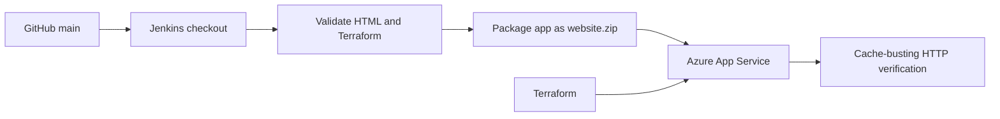

# Automated Web Application Deployment on Microsoft Azure

This project demonstrates a secure, repeatable release path for a static
website: GitHub stores the source, Jenkins validates and packages it, and
Azure App Service serves the verified deployment.

## Architecture



## Prerequisites

- Git, Terraform 1.5+, Azure CLI, and PowerShell
- An authenticated Azure CLI session with access to the target subscription
- A pre-existing Azure resource group, or explicit approval to create one
- Jenkins with Pipeline, Git, Credentials Binding, and Windows agent support
- A Jenkins service principal stored as credentials, never in this repository

## Structure

```text
app/index.html             Static responsive website
terraform/                 Azure App Service infrastructure
Jenkinsfile                Validation, packaging, deployment, verification
.gitignore                 State, secrets, packages, and build output exclusions
```

## Azure authentication and costs

Inspect the active account before using Terraform:

```powershell
az account show
az group list --output table
```

Copy `terraform/terraform.tfvars.example` to `terraform/terraform.tfvars`
only if you need local variable values. The copied file is ignored by Git.
The default plan SKU is `F1`, the free tier permitted by the current student
subscription. Review the Terraform plan before applying; the existing
`devops-rg` resource group is reused.

## Terraform

```powershell
$env:TF_VAR_subscription_id = "<subscription-id>"
terraform -chdir=terraform init
terraform -chdir=terraform fmt -check
terraform -chdir=terraform validate
terraform -chdir=terraform plan
```

Apply only after reviewing and approving the plan:

```powershell
terraform -chdir=terraform apply
```

Terraform state stays local and is ignored. Never run `terraform destroy`
without explicit approval.

## Jenkins configuration

Create a Pipeline job using this repository and the `Jenkinsfile` from SCM.
The pipeline expects these Jenkins Secret Text credential IDs:

| ID | Value |
| --- | --- |
| `AZURE_CLIENT_ID` | Service principal client ID |
| `AZURE_CLIENT_SECRET` | Service principal secret |
| `AZURE_TENANT_ID` | Entra tenant ID |
| `AZURE_SUBSCRIPTION_ID` | Azure subscription ID |

Use least privilege scoped to the target resource group/App Service. The
pipeline does not provision infrastructure; Terraform remains a separate,
reviewed operation.

## Deployment demonstration

Change `DEPLOYMENT-V1` in `app/index.html`, commit, and push to `main`.
Jenkins packages only the contents of `app/`, so `index.html` is at the ZIP
root. The verification stage requests a cache-busting URL and fails unless
the expected title and exact marker are served.

## Troubleshooting

- If Terraform cannot find the resource group, check `resource_group_name`
  and the active subscription.
- If the App Service name is unavailable, choose another globally unique
  `app_service_name`.
- If Jenkins cannot authenticate, confirm the four credential IDs and that
  the agent has `az` on `PATH`.
- If old HTML is served, inspect the ZIP root, verify the commit checked out
  by Jenkins, and retry with a new cache-busting query string.
